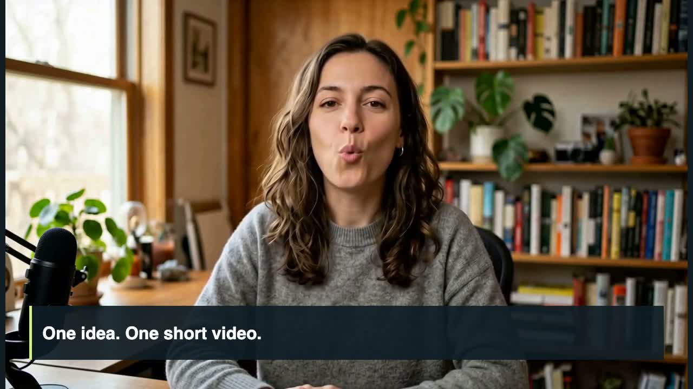

# One idea. One short video.

[Watch the finished film](film.mp4)



This is a real run of the standalone package, made on 2026-10-25. It uses one **5-second fal H3 request at 768P**, followed by an ElevenLabs-narrated motion scene. The assembled film is approximately 11.1 seconds.

The portrait was extracted at 2 seconds from [iArt's previously published AI-generated presenter recording](https://cdn.iart.ai/video-asset/ai-b-roll/compound-original-a.mp4), originally made with HeyGen. The voice is ElevenLabs' **Sarah** preset, not a clone of a real person. No new voice clone was made for this example.

## What was verified

- The real fal endpoint accepted the portrait and ElevenLabs reference speech.
- The short reference take was padded with silence locally to meet fal's two-second minimum; speech was not regenerated.
- The returned video transcribed as exactly “One idea. One short video.”
- H3 reported 6.0 billable units. At the queried rate of $0.05/unit, video generation cost $0.30. ElevenLabs speech and transcription are additional.
- Final media contains picture and sound; the composited review frames have no face-obscuring text.

The transcript and still inspection do not establish voice-clone similarity, human listening approval or frame-perfect lip sync. The sample is a small integration check, not a broad model-quality benchmark. Only one H3 request was made; no replacement takes were purchased.

## Re-render without API calls

From the repository root, after `pnpm run setup`:

```bash
node skills/talking-head/scripts/talking-head.mjs render \
  --manifest examples/one-idea/film.json --out runs/example-rerender/film.mp4
```

Edit `visuals.mjs` to change the graphics. The motion cards use the measured “write”, “choose” and “use” speech anchors. The renderer keeps H3's original audio for `intro.mp4` and uses `steps.mp3` for the motion scene.

`plan.json` and `portrait.jpg` are also included for reproduction through the providers, which incurs new charges. `film.json`, source media, artwork, transcript comparison and `validation.json` document this particular result. Provider request IDs, private storage URLs and credentials are deliberately omitted.
